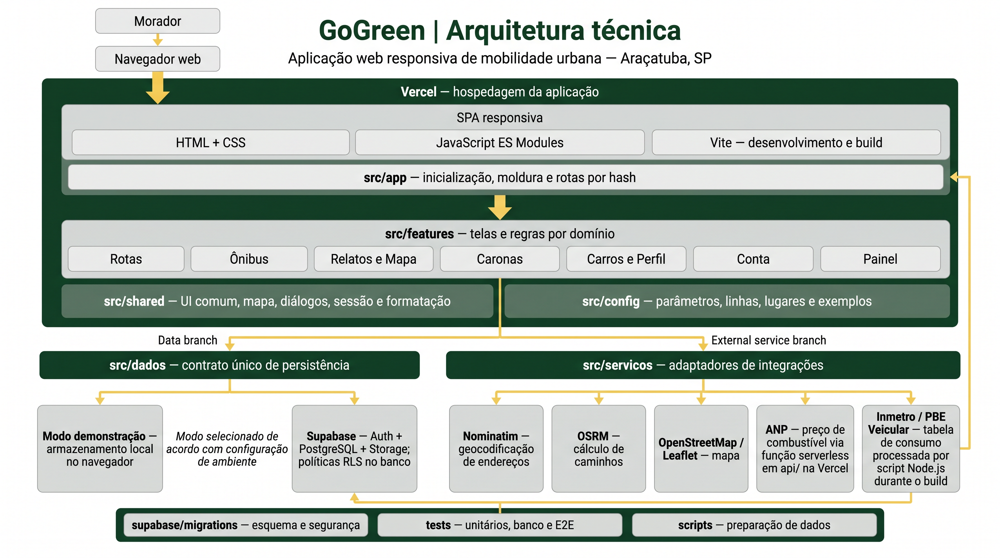
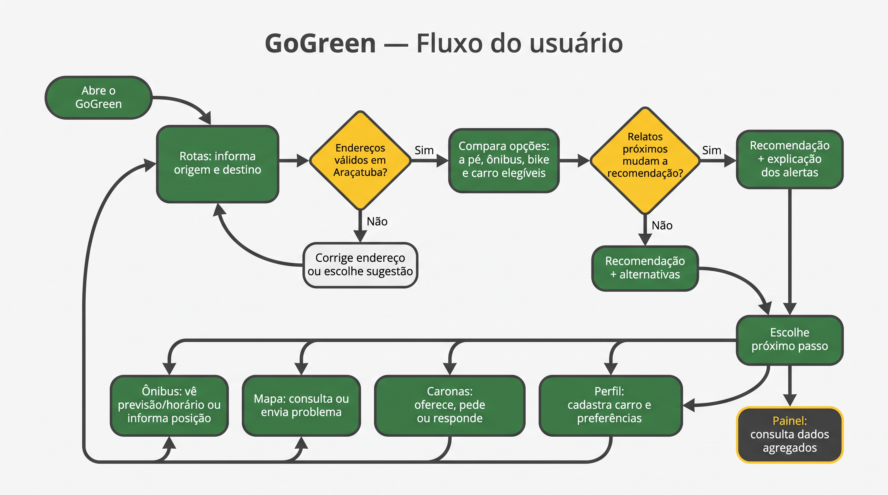

# GoGreen

**Qual é o melhor jeito de chegar lá hoje??**

O GoGreen é um site para quem se locomove por Araçatuba-SP. Ele compara ir a pé, de bike, de ônibus e de carro em tempo, custo e CO₂, e recomenda uma opção levando em conta o que os próprios moradores relatam no caminho.

Projeto da Fatec Araçatuba, com o tema **Mobilidade Urbana e Sustentabilidade**.

**Acesse:** https://gogreen-tulin26s-projects.vercel.app

## O problema

Aplicativos de mapa mostram o caminho mais rápido, mas não sabem que a calçada daquela rua está quebrada, que falta rampa na esquina ou que o ônibus está atrasado. Quem vive na cidade sabe, mas essa informação não chega a quem está decidindo como sair de casa, nem à prefeitura de forma organizada.

## A solução

Os moradores registram problemas e informam onde o ônibus está. O GoGreen usa essas informações para mudar a recomendação de rota e explica o motivo da mudança. Esse é o diferencial do projeto: **o relato de um morador muda a decisão de outro**.

## Funcionalidades

| Aba | O que dá para fazer |
| --- | --- |
| **Rotas** | Comparar a pé, bike, ônibus e carro por tempo, custo e CO₂, e receber uma recomendação com a explicação |
| **Ônibus** | Ver os horários da TUA e acompanhar o ônibus ao vivo quando um passageiro informa a posição, sem identificação |
| **Mapa** | Relatar buraco, calçada ruim, falta de rampa, má iluminação, ponto sem cobertura e atraso, com foto e local, e confirmar relatos de outras pessoas |
| **Caronas** | Oferecer vagas para um destino ou pedir uma vaga. Telefone e placa só aparecem depois que a vaga é aceita, e não há pagamento pelo app |
| **Painel** | Ver os problemas por região e exportar uma planilha em CSV, pensada para a prefeitura |
| **Perfil** | Dizer como você se locomove e cadastrar seus carros |

### Economia por carro

No cadastro ou no perfil, a pessoa informa modelo, ano, placa e combustível de cada carro. Para cada trajeto, o GoGreen calcula o gasto de todos os carros e combustíveis dela e mostra a opção mais barata. O consumo vem das tabelas do Inmetro, de 2010 a 2026, incluindo híbridos e elétricos. O preço dos combustíveis vem da pesquisa semanal da ANP para Araçatuba. Quem não encontra o carro na lista pode informar o consumo à mão.

## Como a recomendação funciona

Cada opção recebe uma nota, e a menor nota é recomendada:

```
nota = minutos + reais + (gramas de CO₂ / 10) + peso dos alertas no caminho
```

- **Alertas:** cada problema só conta para quem é afetado por ele. Calçada ruim pesa para quem vai a pé, poste apagado só à noite e atraso só para o ônibus. Confirmações de outros moradores reforçam o alerta, e relato antigo sem confirmação perde força.
- **Perfil da pessoa:** só entram na recomendação os meios que ela usa, e a opção de rota acessível evita calçada ruim e falta de rampa.
- **Comparação completa:** as opções que ficam de fora continuam aparecendo, com o motivo.

O passo a passo e as fontes também aparecem no próprio site, em **Como calculamos**.

## Tecnologias

| Parte | Tecnologia |
| --- | --- |
| Interface | JavaScript, HTML e CSS, com [Vite](https://vite.dev) |
| Mapas | [Leaflet](https://leafletjs.com) e [OpenStreetMap](https://www.openstreetmap.org) |
| Rotas e endereços | [OSRM](https://project-osrm.org) e [Nominatim](https://nominatim.org) |
| Contas, banco e fotos | [Supabase](https://supabase.com) (PostgreSQL com regras de segurança por linha) |
| Hospedagem | [Vercel](https://vercel.com) |
| Testes | Testes do Node, [PGlite](https://pglite.dev) e [Playwright](https://playwright.dev) |

## Como o sistema é organizado



## Fluxo do usuário



## Documentos do projeto

- [Backlog priorizado com o método MoSCoW](Backlog%20(MoSCoW).docx)
- [Arquitetura técnica](Diagrama_tecnico.png)
- [Fluxo do usuário](Diagrama_fluxo_usuario.png)

## Privacidade e segurança

- As permissões ficam no banco, e não no navegador.
- Os dados de cada carro, incluindo a placa, são visíveis só para a pessoa dona dele. Quem pega carona vê a placa e o WhatsApp apenas depois que a vaga é aceita.
- A posição do ônibus é enviada sem nome, e só enquanto a pessoa estiver informando.

## Dados e fontes

| Dado | Valor | Fonte |
| --- | --- | --- |
| CO₂ do carro | 98,2 g por passageiro.km | [BNDES, Souza e Vaz](https://web.bndes.gov.br/bib/jspui/bitstream/1408/27427/1/PRCapLiv_216304_%C3%94nibus%20el%C3%A9tricos%20e%20a%20descarboniza%C3%A7%C3%A3o%20da%20mobilidade%20urbana.pdf) |
| CO₂ do ônibus a diesel | 19,5 g por passageiro.km | Mesma fonte |
| Tarifa comum | R$ 5,30, confirmada em dez/2025 | [O Liberal Regional](https://lr1.com.br/cidades/aracatuba/tarifa-do-transporte-coletivo-pode-subir-para-r-1368-sem-subvencao-reprovada-pela-camara/) |
| Passe escolar | R$ 2,65, em abr/2025 | [Hojemais](https://www.hojemais.com.br/aracatuba/noticia/cotidiano/transporte-coletivo-em-aracatuba-tera-tarifa-zero-aos-domingos-e-feriados) |
| Gasolina, etanol e diesel em Araçatuba | Média semanal, atualizada automaticamente | [ANP](https://www.gov.br/anp/pt-br/assuntos/precos-e-defesa-da-concorrencia/precos/levantamento-de-precos-de-combustiveis-ultimas-semanas-pesquisadas) |
| Consumo dos carros | Modelos de 2010 a 2026 | [Inmetro, PBE Veicular](https://www.gov.br/inmetro/pt-br/assuntos/regulamentacao/avaliacao-da-conformidade/programa-brasileiro-de-etiquetagem/tabelas-de-eficiencia-energetica/veiculos-automotivos-pbe-veicular) |
| Linhas e horários da TUA | 14 linhas, quadro de 20/09/2026 | [onibus.online](https://onibus.online/empresas/tua-transportes-urbanos-aracatuba/) |
| Limites dos serviços de rota | 1 requisição por segundo, uso não comercial | [OSRM](https://github.com/Project-OSRM/osrm-backend/wiki/Demo-server) |
| Base legal do tema | Acessibilidade universal e gestão democrática | [Lei 12.587/2012](https://www.mprj.mp.br/documents/20184/226705/Lei_12587.pdf) |

**Suposições do projeto, ajustáveis em `src/config/transporte.js`:** carro sem cadastro faz 12 km/l; energia a R$ 1,00 por kWh para carro elétrico (em `src/config/combustiveis.js`); ônibus anda a 20 km/h, com 10 min de espera e 10 min de caminhada; pesos da nota da recomendação.

## Limites conhecidos

- **Itinerário das linhas:** a fonte não publica as ruas, então o app não desenha o traçado real. O tempo de ônibus é uma estimativa sobre o caminho de carro, e a previsão ao vivo usa a distância até você.
- **Linha 118:** a página da fonte não trazia horários.
- **Feriados e tarifa:** o quadro não trata feriados, e a tarifa de 2026 precisa ser confirmada com a TUA ou a prefeitura.
- **Servidores públicos:** OSRM e Nominatim são gratuitos e sem garantia. Para uso real, é preciso hospedar os próprios ou contratar um serviço.
- **Moderação:** não há fila de revisão de fotos, só limite de envios, exclusão pelo autor e pela equipe.
- **Preço dos combustíveis:** a ANP publica por semana, não por dia. Se a consulta falhar, o app usa o último valor salvo e avisa na tela.
- **Consumo dos carros:** os valores são de laboratório, e no dia a dia variam com o jeito de dirigir e o estado do carro.
- **Caronas:** o app não confere a identidade de ninguém, e os 18 anos são só declarados pela pessoa.
- **Relato sem internet:** o formulário mantém os dados, mas não envia depois sozinho.
